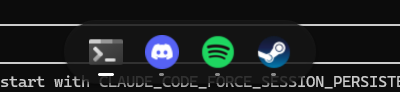
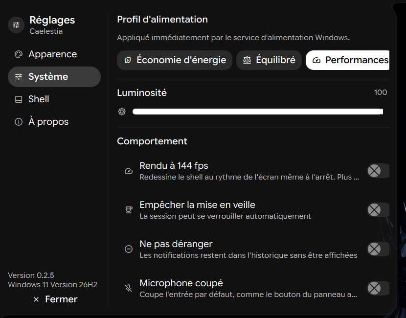
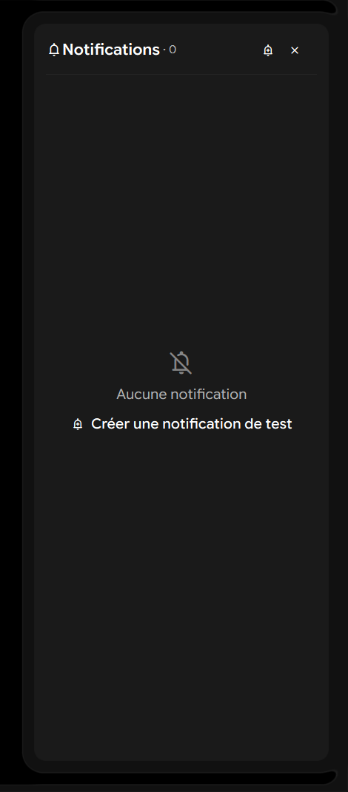
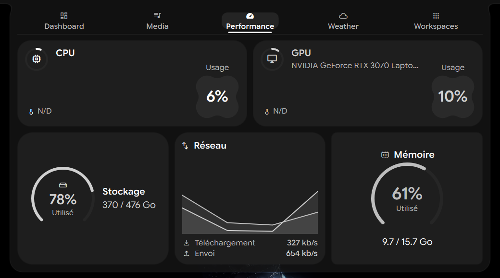

# Caelestia Shell — Windows 11

Barre Caelestia intégrée au bureau Windows 11 comme **AppBar réelle sur chaque
écran**, avec fenêtre active réelle, status système réel et **icône System Tray
Caelestia réelle**. Le DPI par écran est géré en Per-Monitor V2.

Windows Explorer continue de fournir le bureau, mais la barre des tâches et
les icônes du bureau sont masquées tant que le shell tourne, pour laisser la
place au bureau Caelestia ; leur état d'origine est restauré à la fermeture.
Le design de la barre reste celui de la première version ; le gestionnaire de
fenêtres et les modules portés depuis Caelestia Linux sont documentés plus bas.

## Aperçu

| | |
|---|---|
|  |  |
| La barre : bureaux virtuels, fenêtre active, horloge, statut. | Le dock, révélé au survol du bord inférieur. |
|  |  |
| Nexus > Système : profils d'alimentation, luminosité, comportement. | Le dock de notifications, révélé par le bord droit. |



L'onglet Performance du tableau de bord : cartes héro CPU/GPU dont la forme
suit la charge, stockage, réseau et mémoire.

## Langue

L'interface suit la **langue d'affichage de Windows**. Les sources sont en
français ; `I18n.qml` fournit la traduction anglaise et tout libellé absent du
tableau retombe sur le texte français plutôt que sur un vide. `CAELESTIA_LANG=en`
force la langue pour vérifier la traduction sans toucher aux réglages Windows.

## Prérequis

| Outil | Version testée |
|---|---|
| Windows | 11, build 26300 |
| Visual Studio Build Tools 2022 | 17.14 (MSVC 19.44) |
| Qt | 6.9.3 MSVC 2022 x64 + Qt Shader Tools + Qt SVG |
| CMake | 3.31.6 |
| Ninja | 1.12.1 |

## Compilation

```powershell
powershell -ExecutionPolicy Bypass -File "C:\Users\axsou\Documents\shell-win11\windows\scripts\build.ps1" -Clean -Deploy
```

Lancement :

```powershell
.\build\bin\caelestia-shell.exe
```

Fermeture propre : menu tray → « Quitter Caelestia », `Ctrl+Q`, `Alt+F4` ou
fermeture de la fenêtre.

Un second lancement ne crée ni AppBar ni icône tray supplémentaire : il se
termine immédiatement avec le code 0.

## Portabilité

Ce qui rend le shell dépendant de la machine, et ce qui a été fait pour que ça
tienne ailleurs :

- **Bureaux virtuels.** Ils passent par une interface COM privée dont l'ordre
  de vtable change d'une build à l'autre. Windows change alors aussi l'**IID**
  de l'interface — c'est la convention sur laquelle s'appuient tous les outils
  du domaine — donc le shell demande son IID et laisse le service répondre :
  sur une build au layout différent, `QueryService` renvoie `E_NOINTERFACE` et
  la colonne de bureaux se masque, au lieu d'appeler une vtable incorrecte et de
  planter. Il n'y a volontairement plus de liste de builds « supportées » : elle
  désactiverait les bureaux sur toute version non encore vue, alors que l'IID
  répond exactement à la question. Le message d'erreur cite la build détectée.
- **Runtime Visual C++.** `vcruntime140*.dll`, `msvcp140*.dll` et `concrt140.dll`
  sont copiés à côté de l'exécutable : aucune installation de la redistribuable
  n'est nécessaire sur la machine cible.
- **Rendu.** D3D11 par défaut ; `opengl32sw.dll` est déployé, donc une machine
  sans pilote D3D11 utilisable retombe sur le rendu logiciel au lieu d'échouer.
- **DPI et résolutions.** Toutes les tailles sont en pixels logiques, les AppBars
  multiplient par le DPI du moniteur (`dpiForMonitor`), et la bande du dock est
  proportionnelle à la hauteur de l'écran (11,5 %, bornée à 96–128 px) — sur un
  portable 768p elle ne mange pas un sixième de l'écran.
- **Écrans.** Un ou plusieurs moniteurs, DPI différents inclus : une barre, un
  overlay et un dock par écran, chacun réservé par son AppBar.
- **Aucun chemin ni matériel en dur.** Les réglages vivent sous
  `HKCU\Software\Caelestia`, la capture audio et le GPU sont détectés puis
  désactivés proprement s'ils manquent.
- **Réversibilité.** La barre des tâches Windows est restaurée à la fermeture
  normale et au démarrage suivant si le shell a été tué (`shell/taskbarHeld`).

## Architecture

### AppBar multi-écrans
- `Platform::screens` retourne un `QVariantList` de `QScreen*` trié par position
  (X, puis Y, puis nom) ; il ne dépend pas de l'ordre de
  `QGuiApplication::screens()`.
- `Main.qml` crée une `Window` et une AppBar par écran via `Instantiator`.
- Chaque AppBar utilise `ABM_NEW`, `ABM_QUERYPOS`, `ABM_SETPOS` (`ABE_LEFT`),
  `ABM_REMOVE` et `ABN_POSCHANGED` sur son propre HWND.
- Le `HMONITOR` est obtenu directement depuis `QScreen` via
  `QWindowsScreen::handle()`, sans dépendre de `MonitorFromWindow` avant que la
  fenêtre soit positionnée.
- Largeur logique fixe de 60 px, convertie avec `GetDpiForMonitor` /
  `GetDpiForWindow` ; la zone de travail Windows réserve la largeur physique
  correspondante.

### Changements d'écran et DPI
- `QGuiApplication::screenAdded` / `screenRemoved` déclenchent la reconstruction
  du modèle QML au tick suivant, après que Qt a terminé sa gestion interne des
  moniteurs.
- À la déconnexion, l'AppBar de l'écran supprimé est désenregistrée et masquée
  avant la destruction de sa fenêtre.
- À la reconnexion, une nouvelle AppBar est créée et la zone de travail est
  réservée à nouveau.
- `WM_DISPLAYCHANGE`, `WM_DPICHANGED`, `WM_SETTINGCHANGE` et les changements de
  géométrie d'écran rafraîchissent les réservations.
- Per-Monitor DPI Awareness V2 est actif (vérifié sur les HWND Caelestia :
  `awareness=2`, contexte V2).
- Les changements de résolution, de topologie et d'écran principal sont pris en
  charge sans redémarrage.

### Instance unique
Mutex Win32 nommé `Local\CaelestiaShellWindows`, libéré par l'OS même en cas
d'arrêt brutal. Aucune seconde AppBar ni icône tray n'est créée.

### Bureau Windows masqué
`Platform` masque la barre des tâches (`Shell_TrayWnd` /
`Shell_SecondaryTrayWnd`) et les icônes du bureau (`SysListView32` sous
`SHELLDLL_DefView`) tant que le shell tourne :

- la barre passe en auto-hide (`ABM_SETSTATE`) puis `ShowWindow(SW_HIDE)` ;
  l'auto-hide élargit la zone de travail, la visibilité la retire de l'écran ;
- la liste d'icônes est simplement cachée (`ShowWindow`), ce que fait aussi la
  case « Afficher les icônes du bureau » de Windows — aucune suppression de
  raccourci, donc rien à recréer ;
- un timer de 250 ms réapplique les deux si Explorer les recrée (rafraîchissement,
  redémarrage du shell) et retente tant qu'elles n'existent pas encore au login ;
- `aboutToQuit` restaure l'état exact (visibilité d'origine et état AppBar),
  avec un drapeau dans `QSettings` (`shell/taskbarHeld`,
  `shell/desktopIconsHeld`) qui répare aussi une session précédente tuée
  brutalement.

Après un `taskkill /F`, la barre et les icônes restent donc masquées jusqu'au
prochain lancement du shell (qui restaure puis masque à nouveau) ou jusqu'au
redémarrage d'Explorer. `F8` et les panneaux restent utilisables ; pour
récupérer le bureau sans relancer, `taskkill /f /im explorer.exe` puis relancer
`explorer.exe` suffit.

### Fenêtre active
`SetWinEventHook` foreground/name/minimize/destroy, `GetWindowTextW`, icône
`WM_GETICON` / classe / `SHGetFileInfoW`.

### Status
`BatteryService` (`GetSystemPowerStatus` + `WM_POWERBROADCAST`),
`NetworkService` (WLAN + IP Helper), `BluetoothService` (WinRT Radio pour
l'adaptateur, `bthprops` pour les appareils), `AudioService` (WASAPI +
callbacks, sortie et micro), `PowerProfileService` (overlay d'alimentation,
repli sur les power schemes), `IdleInhibitService` (demandes d'éveil système et
écran).

### System Tray
- `TrayService` utilise `Shell_NotifyIconW` :
  - `NIM_ADD`, `NIM_SETVERSION` (`NOTIFYICON_VERSION_4`), `NIM_DELETE` ;
  - `NIM_SETFOCUS` ;
  - `NIF_ICON | NIF_MESSAGE | NIF_TIP | NIF_SHOWTIP`, GUID stable.
- Icône générée depuis `assets/logo.svg` original, recoloré avec les couleurs
  du thème ; aucun nouveau logo.
- Menu natif `CreatePopupMenu` / `TrackPopupMenuEx` :
  - « Ouvrir la zone de notification » ;
  - « Quitter Caelestia ».
- Callbacks `WM_CONTEXTMENU`, `NIN_SELECT`, `NIN_KEYSELECT`,
  `NIN_BALLOONUSERCLICK`.
- La zone tray de la barre affiche une **seule icône Caelestia réelle** (24 px),
  cliquable pour ouvrir le même menu.

### Limite documentaire du tray
Aucune API Win32 documentée ne permet d'énumérer ou de récupérer les icônes des
autres applications. `Shell_NotifyIcon` gère uniquement l'icône de
l'application appelante ; `Shell_NotifyIconGetRect` exige l'identité de l'icône.
Les interfaces `ITrayNotify` / `ITrayDeskBand` sont non documentées et ne sont
pas utilisées. L'UI Automation ne fournit pas les images des icônes et dépend
d'une arborescence XAML instable ; elle n'est pas utilisée pour simuler le tray.

Les icônes Discord, Steam, Firefox et autres restent donc dans la **zone de
notification Windows native**. La barre Caelestia n'en affiche pas de copies.

## Tests effectués (9–12 novembre 2026)

| Test | Résultat |
|---|---|
| Build + déploiement + smoke test | OK, exit 0 |
| qmllint (cible CMake `caelestia-shell_qmllint`) | 0 erreur ; warnings d'accès non qualifié sur `Caelestia.Platform` (singletons C++ absents du qmltypes) et 5 `missing-property` sur des objets `var` (faux positifs) |
| Démarrage avec deux écrans, DPI différents | 2 AppBars : 75 px physiques (60 logiques, 125 %) et 60 px (100 %) ; zones de travail réservées 75 px / 60 px |
| Démarrage avec un seul écran | 1 AppBar 60×1032 ; zone de travail 60→1920 |
| Déconnexion de DISPLAY1 (`ChangeDisplaySettingsEx`) | application stable, AppBar détruite, zone de travail libérée, aucune exception |
| Reconnexion de DISPLAY1 (`SetDisplayConfig` extend) | AppBar recréée 75×1020 à −1920,0 ; zone de travail re-réservée |
| Changement de résolution DISPLAY5 (1280×720) | AppBar 60×672, zone de travail correcte ; retour 1920×1080 validé |
| Changement d'écran principal (DISPLAY1 en 0,0) | AppBars 75 px / 60 px aux bons bords, zones de travail correctes ; disposition d'origine restaurée |
| Deuxième lancement | exit 0 en ~1 s, un seul processus, aucune AppBar ni icône supplémentaire |
| Fermeture normale (WM_CLOSE) | application terminée, réservations AppBar retirées, zones de travail restaurées |
| Absence de doublons | une seule AppBar visible par écran après chaque événement testé |
| Phases précédentes | icône tray enregistrée, status, fenêtre active et rendu QML toujours fonctionnels |

## Tests non effectués

- **Scaling 150 / 175 / 200 %** : Windows ne fournit pas d'API publique pour
  modifier le facteur par moniteur à chaud ; le test nécessite l'interface
  Paramètres et une reconnexion de session. Le code utilise le DPI réel du
  moniteur, mais ces valeurs n'ont pas été validées physiquement.
- **Débranchement physique d'un câble** : la déconnexion/reconnexion a été
  simulée par les API de configuration d'affichage, pas par un débranchement.
- **Veille / reprise et verrouillage de session** : non testés.
- **Arrêt forcé** (`taskkill` / `TerminateProcess`) : non validé ; la
  restauration des zones de travail n'est garantie que pour une fermeture
  normale.
- **Menu tray et commandes** : non rejoués depuis l'ajout du menu ; le code du
  tray est inchangé et l'icône est enregistrée au démarrage.
- **Icônes tierces dans la barre** : impossible avec les API documentées.

## Tiling Windows

**Le tiling est désactivé sur ce port** (`tilingEnabled = false` dans
`WindowManagerService`) : les fenêtres gardent la taille et la position que
Windows leur a données. Ce qui reste actif : focus, `Win+C`, les bureaux, le
dock, le glissement au changement de bureau et le plein écran. Ce qui disparaît
avec lui : les raccourcis propres au tiling (`Win+Flèches`, `Win+Shift+Flèches`,
`Win+±`, layouts, resize) ne sont plus enregistrés ni avalés, donc **Windows
reprend ses propres accrochages** (`Win+←/→`, `Win+↑` maximiser, `Win+↓`,
loupe `Win+±`). Réactivation possible en écrivant `tiling=true` dans le fichier
INI `Caelestia/window-manager`.

Le shell inclut un gestionnaire de fenêtres réel inspiré de Hyprland :
layout Dwindle par défaut, Master, Split horizontal/vertical, tiling strict,
floating, focus directionnel, déplacement entre bureaux et coupe-circuit.
Les raccourcis `SUPER+…` de Caelestia sont remplacés par des alternatives
`Ctrl+Alt+…` lorsque Windows les réserve ; `Ctrl+Alt+Shift+T` active/désactive
le tiling et `Ctrl+Alt+Shift+Escape` restaure les fenêtres. Détails :
`docs/hyprland-window-management-report.md`.

Les raccourcis Hyprland les plus courants sont disponibles avec la touche
Windows comme `SUPER` : `Win+Entrée` ou `Win+Q` ouvrent le terminal, `Win+C`
ferme la fenêtre active, `Win+1`…`Win+0` changent de bureau (avec `Win+Maj`
pour déplacer la fenêtre), `Win+E` ouvre l'explorateur et `Win+N` la barre
latérale.

**La touche Windows appartient au shell**, comme `SUPER` sous Hyprland : le hook
avale l'appui *et* le relâchement, donc Windows ne voit jamais le modificateur.
Un appui seul ouvre le lanceur Caelestia (il est « seul » tant qu'aucune autre
touche n'a été enfoncée et qu'aucun clic n'a eu lieu pendant qu'il est tenu —
`Win+C`, `Win+clic` ou `Win+flèche` continuent de faire ce qu'ils font).
Windows, de son côté, n'ouvre plus Start et ne cherche plus d'application.

Ce choix a une raison précise : la première version laissait passer l'appui et
n'avalait que le relâchement, pour empêcher Start de s'ouvrir. Windows gardait
alors son état clavier avec `Win` enfoncée — la frappe suivante, un simple `s`,
arrivait comme `Win+S` et ouvrait la recherche du menu Démarrer. Avaler les
deux événements est le seul moyen de ne rien laisser derrière soi.

Conséquence : les combinaisons propres à Windows que le shell ne revendique pas
n'atteignent plus Windows (`Win+Tab`, `Win+I`, `Win+A`, `Win+V`, `Win+X`,
`Win+P`, `Win+D`). Les gestes utiles gardent un équivalent : `Win+S` ouvre le
lanceur, `Win+L` l'écran de verrouillage du shell, `Win+Shift+S` le sélecteur de
capture. Avec le gestionnaire de fenêtres désactivé
(`Ctrl+Alt+Shift+Escape`), l'avalement s'arrête et Windows retrouve la touche.

Ce choix de touches est un écart volontaire par rapport à Caelestia : le
`SUPER+Q` d'origine (fermer) devient `SUPER+C`, et le `SUPER+C` d'origine
(éditeur) n'existe plus en `Win+…`, comme sous Hyprland. Les deux actions
restent joignables par `Ctrl+Alt+Q` (fermer) et `Ctrl+Alt+C` (éditeur).

`RegisterHotKey` ne peut pas prendre ces combinaisons : Explorer les possède
déjà (`Win+Q`, `Win+1`…`0`, `Win+E`, `Win+T`, `Win+Flèches`…) et
l'enregistrement échoue. Les combinaisons `Win+…` restantes sont donc
capturées par un hook clavier bas niveau (`WH_KEYBOARD_LL`) installé par
`WindowManagerService` : le hook voit la touche avant Explorer, avale la
combinaison et poste l'action à la boucle Qt, puis avale aussi le relâchement
de la touche Windows pour que le menu Démarrer ne s'ouvre pas. Les répétitions
automatiques sont filtrées et l'état `enabled` du service coupe le hook, ce
qui reste le moyen de secours si `Ctrl+Alt+Shift+Escape` est lui aussi pris.
Un `Win+Entrée` déjà détenu par Narrator suit le même chemin ; la liste de
Nexus > Shell affiche l'état réel de chaque raccourci.

### Déplacer, fermer, encadrer

Trois choix rapprochent les fenêtres natives de Hyprland :

- **Déplacer : `Win` + bouton gauche.** Un hook souris bas niveau
  (`WH_MOUSE_LL`) voit le clic avant l'application visée. Si `Win` est tenu et
  que le clic tombe sur une fenêtre gérée, le shell avale le bouton, sort la
  fenêtre du tiling (`floating`) et la déplace lui-même avec `SetWindowPos` au
  fil des mouvements. Le relâchement rend la main au tiling et la fenêtre reste
  flottante, comme sous Hyprland. Sans `Win`, clics et molette passent
  inchangés : aucune application ne perd son glisser-déposer interne.
- **Pas de boutons de légende.** Fermer se fait avec `Win+C`. Chaque fenêtre
  gérée perd `WS_MINIMIZEBOX | WS_MAXIMIZEBOX | WS_SYSMENU` en conservant
  `WS_CAPTION` et `WS_THICKFRAME` : elle reste déplaçable, redimensionnable et
  éligible au tiling, mais les trois glyphes ne sont plus dessinés et le menu
  système n'est plus accessible. Le retrait est appliqué pendant le scan, avant
  la passe de géométrie, pour que le tiling mesure déjà le bon cadre.
- **Pas de contour de focus.** Caelestia dessine une bordure `primary` de 2 px
  autour de la fenêtre active ; sous Windows, la fenêtre de bordure séparée
  apparaissait comme un liseré blanc qui suivait la souris. Elle a été
  supprimée : le focus se lit dans la barre (icône et titre de la fenêtre
  active), pas autour des fenêtres natives.

## Profondeur de la surface

Le blob (`ScreenSurface`, shader `blob.frag`) est la seule surface du shell : le
cadre de 10 px, la barre de 60 px, la sidebar, le tableau de bord, les popouts et
le launcher sont fusionnés en une forme SDF unique. Trois indices la détachent
du fond d'écran :

- **Ombre portée** — dessinée par `blob.frag` lui-même : le shader réévalue la
  SDF du blob au point décalé et n'écrit que là où le pixel est hors du blob,
  sur les quelques pixels de la couronne. Ce n'est pas un détail de style mais
  une question de coût : la première version passait par un `MultiEffect` sur
  une couche plein écran (`blurMax: 24`, `shadowBlur: 0.6`), soit ~20 ms par
  image sur le GPU intégré — le shell tombait à ~50 fps pendant l'ouverture
  d'un panneau, alors que l'écran est à 144 Hz.
- **Liseré** — `blob.frag` éclaircit de 6 % une bande de 2 px le long du
  contour (`abs(d)`), paroi du trou comprise, et donc aussi le raccord arrondi
  là où un panneau quitte la barre. Sur un fond sombre c'est ce liseré, et non
  l'ombre, qui sépare le shell du fond.
- **Surface visible** — `Monochrome` peint `#161616` et non `#000000` : un
  shell noir sur un fond noir n'existe pas à l'écran, seuls les glyphes
  blancs ressortaient.
- **Transparence** — `theme.surface` porte l'alpha réglé dans Nexus
  (90 % par défaut). Les fenêtres du shell sont déjà translucides
  (`color: "transparent"` + sans bordure), donc le fond d'écran traverse la
  barre, le cadre et les popouts. Seul `surface` reçoit l'alpha : les cartes
  empilées dessus gardent leur propre remplissage opaque, sinon deux couches
  à 0,9 donneraient 0,99 et les panneaux paraîtraient pleins.

## Onglet média : paroles et lecture fluide

- **Position fluide** — `MediaService` interroge GSMTC une fois par seconde,
  donc `Media.positionMs` arrivait par paliers d'une seconde et le curseur
  sautait d'un cran à chaque sondage. `DashboardMedia` extrapole depuis le
  dernier échantillon (`anchorMs + Date.now() - anchorAt`) via une
  `FrameAnimation`, puis se réancre à chaque nouvel échantillon : le temps
  écoulé et le curseur avancent à chaque image, et un déplacement manuel reste
  immédiat. Comme toutes les propriétés du service partagent le même signal
  `changed`, la surveillance passe par deux propriétés dérivées
  (`mediaSample`, `mediaPlaying`) — c'est le seul moyen d'obtenir un handler
  par champ.
- **Paroles** — `LyricsService` interroge lrclib.net (gratuit, sans clé) :
  `/api/get` avec l'artiste, le titre, l'album et la durée, puis
  `/api/search` en secours quand le morceau n'est pas reconnu à l'identique
  (remaster, « feat. »). Le LRC (`[mm:ss.xx]`) est analysé en lignes
  horodatées, balise `[offset:]` comprise ; sans version synchronisée, les
  paroles brutes défilent à la main.
- La ligne chantée est trouvée par dichotomie sur `playheadMs` à chaque image,
  mise en avant et recentrée dans la colonne ; les autres sont estompées.
- Rien n'est écrit sur disque, mais un cache mémoire de 16 morceaux évite de
  refaire la requête quand on revient en arrière. Le titre et l'artiste en
  cours partent donc vers lrclib.net : c'est le prix de la fonctionnalité, et
  une requête n'est faite que lorsque le morceau change ou que l'onglet
  s'ouvre.
- `--lyrics "Artiste" "Titre" [durée]` teste le service en ligne de commande.

## OSD volume et luminosité

Le pilule OSD de Caelestia (volume, luminosité, message transitoire) est
réimplémentée avec les services Windows natifs.

- **Luminosité** — `BrightnessService` pilote le rétroéclairage du moniteur
  principal en DDC/CI (`GetVCPFeatureAndVCPFeatureReply` / `SetVCPFeature`,
  code VCP `0x10`), comme `brightnessctl` sous Linux. Les appels VCP sont des
  transactions I2C lentes (~100 ms) : lecture et écriture tournent sur un
  worker `QtConcurrent`, la valeur QML est publiée de façon optimiste puis
  réconciliée avec la relecture du moniteur (certains panneaux arrondissent).
  Un seul worker à la fois : les demandes suivantes sont coalescées et seule la
  dernière valeur en attente est écrite. Une relecture automatique toutes les
  20 s garde l'état aligné si le rétroéclairage change par un autre moyen.
- **Volume** — l'OSD n'est affiché que pour les actions déclenchées par le
  shell (raccourcis ci-dessous, appel QML explicite). Il n'écoute volontairement
  pas `AudioService::changed` : les touches média matérielles font déjà
  apparaître l'OSD natif de Windows, et le refléter produirait deux indicateurs
  pour un seul geste.
- **Rendu** — `OsdSurface.qml`, en haut à droite de l'écran principal, dans
  l'overlay click-through (il ne prend jamais l'input). Il se décale de la
  largeur de la sidebar quand celle-ci est ouverte.

Raccourcis globaux (`RegisterHotKey`, `Ctrl+Alt+…` afin de ne pas heurter les
`Ctrl+Alt+Flèches/HJKL` du tiling) :

| Raccourci | Action |
|---|---|
| `Ctrl+Alt+F12` | Luminosité +5 % |
| `Ctrl+Alt+F11` | Luminosité −5 % |
| `Ctrl+Alt+F10` | Volume +5 % |
| `Ctrl+Alt+F9` | Volume −5 % |

Les raccourcis non disponibles (déjà pris par un pilote ou un autre logiciel)
sont ignorés silencieusement ; `CAELESTIA_DEBUG_OSD=1` les journalise.
`CAELESTIA_DEBUG_BRIGHTNESS=1` journalise chaque état DDC/CI.

## Sélection des périphériques audio

`AudioService` énumère les endpoints actifs (`IMMDeviceEnumerator::
EnumAudioEndpoints`, `DEVICE_STATE_ACTIVE`) et expose deux listes `{ id, name }`
— `outputs` et `inputs` — plus les ids par défaut `defaultOutputId` /
`defaultInputId`. Le popout Audio affiche chaque liste en `M3ListItem`
sélectionnable, comme les `Audio.sinks` / `Audio.sources` du popout Linux.

Le changement de périphérique par défaut n'a pas d'API documentée. Le service
utilise `IPolicyConfig` (CLSID `870af99c-…`, interface
`f8679f50-850a-41cf-9c72-430f290290c8`), l'interface employée par Explorer et
par SoundSwitch/nircmd. Elle est déclarée avec le vtable complet dans
`audioservice.cpp` et appliquée aux trois rôles Windows (`eConsole`,
`eMultimedia`, `eCommunications`) : ne changer que `eConsole` laisserait les
lecteurs multimédias sur l'ancienne sortie.

Les notifications `IMMNotificationClient` (ajout, retrait, changement d'état,
renommage, changement de défaut) rafraîchissent listes et défauts ; les
callbacks COM arrivent sur un thread worker et repassent par
`QMetaObject::invokeMethod` avant de toucher l'état visible en QML.

`CAELESTIA_DEBUG_STATUS=1` journalise le nombre de sorties/entrées détectées.

## Appairage Bluetooth

`BluetoothService` combine deux API, chacune pour ce qu'elle fait le mieux :

- **Radio** — WinRT `Windows.Devices.Radios` fournit l'état de l'adaptateur et
  son activation/désactivation (`SetStateAsync`), plus une notification
  `StateChanged` quand un autre logiciel ou le mode avion le bascule. WinRT
  exige son propre appartement COM, d'où un thread worker dédié.
- **Appareils** — l'énumération WinRT des appareils Bluetooth ne retourne rien
  pour les périphériques classiques tant que l'application n'est pas empaquetée
  (capacités `bluetooth` absentes du manifeste). Le service utilise donc
  `bluetoothapis.h` (`bthprops`), qui fonctionne pour un exécutable non
  empaqueté : `BluetoothFindFirstDevice` (`fReturnRemembered`,
  `fReturnAuthenticated`, `fReturnConnected`), `BluetoothAuthenticateDeviceEx`
  pour l'appairage et `BluetoothRemoveDevice` pour la dissociation.

Toutes les commandes passent par une file traitée par le worker
(`SetRadio`, `Refresh`, `Scan`, `Pair`, `Unpair`) : une recherche classique
bloque plusieurs secondes et ne peut jamais tourner sur le thread GUI. Chaque
résultat est republié via `QMetaObject::invokeMethod(..., Qt::QueuedConnection)`.

Le popout Bluetooth affiche `Bluetooth.devices` (`{ address, name, connected,
paired }`), un bouton **Rechercher** (`scanDevices`, enquête d'environ 5 s) et
un bouton d'action par ligne — **Appairer** ou **Dissocier**, la ligne entière
étant cliquable. Les échecs (appairage refusé, adaptateur verrouillé par une
stratégie) remontent dans `toggleFailed` et s'affichent en rouge dans le popout
plutôt que d'échouer silencieusement.

Limites assumées :

- L'enquête Win32 est l'enquête Bluetooth **classique** ; les appareils
  exclusivement BLE non encore appairés n'apparaissent pas. Ils restent
  appairables depuis les Paramètres Windows, et le popout y renvoie.
- `BluetoothAuthenticateDeviceEx` déclenche l'UI d'appairage sécurisé de
  Windows quand un code doit être confirmé. Les appareils à PIN fixe échouent
  avec le message Win32 d'origine.

`CAELESTIA_DEBUG_STATUS=1` journalise l'état de la radio et le nombre
d'appareils à chaque rafraîchissement.

## Mode d'alimentation

`PowerProfileService` expose le sélecteur à trois positions
Économie d'énergie / Équilibré / Performances du popout Batterie — le
`PowerProfiles.profile` du shell Linux.

Windows superpose deux mécanismes, et le service suit délibérément le premier :

- **Overlay** (mode d'alimentation, ce que montre l'application Paramètres de
  Windows 11). C'est le vrai équivalent des trois profils Linux. Il est appliqué
  par `PowerSetActiveOverlayScheme` (`powrprof.dll`), résolu dynamiquement par
  `GetProcAddress` : la fonction n'est pas exportée par toutes les versions et
  n'est pas déclarée dans les en-têtes du SDK.
- **Power schemes** (modes de gestion de l'alimentation du panneau classique).
  Énumérés par `PowerEnumerate` / `ACCESS_SCHEME`, nommés par
  `PowerReadFriendlyName` et activés par `PowerSetActiveScheme`. Ce chemin sert
  de repli quand l'overlay n'est pas disponible.

L'état courant de l'overlay se lit dans
`HKLM\SYSTEM\CurrentControlSet\Control\Power\User\PowerSchemes`
(`ActiveOverlayAcPowerScheme`, ou `ActiveOverlayDcPowerScheme` sur batterie).
`PowerGetActiveOverlayScheme` n'existe qu'à partir de Windows 11 22621 et
`PowerGetEffectiveOverlayScheme` décrit ce que produit le *plan* actif, pas ce
que l'utilisateur a choisi : la valeur de registre est la seule lecture
portable. Elle est relue toutes les 5 s pour suivre un changement fait dans
Windows.

Limite assumée : le plan et l'overlay restent deux réglages distincts. Le shell
affiche l'overlay, comme le fait l'application Paramètres ; un plan
« Haute performance » choisi dans le panneau classique n'apparaît donc pas dans
le popout.

`CAELESTIA_DEBUG_STATUS=1` journalise le mode retenu et le profil actif.

## Utilitaires (garder éveillé, micro, ne pas déranger)

La sidebar reprend la carte « Keep awake » et la rangée de bascules rapides du
module `utilities` de Caelestia.

- **Garder éveillé** — `IdleInhibitService` crée une demande d'éveil
  (`PowerCreateRequest` + `PowerSetRequest` en `PowerRequestSystemRequired` et
  `PowerRequestDisplayRequired`), l'équivalent Windows d'`Inhibit` sur
  `org.freedesktop.login1`. La demande apparaît dans `powercfg /requests`, et
  l'OS la libère de lui-même si le processus disparaît. Le service la retire
  explicitement à la fermeture, et les deux requests sont annulées ensemble si
  Windows n'en accepte qu'une. Un refus est remonté par `actionFailed` et
  affiché sous la ligne : la bascule ne reste jamais allumée à tort.
- **Micro** — `AudioService` expose `micMuted` et `toggleMicMute()` sur
  l'endpoint de capture par défaut (`IAudioEndpointVolume::SetMute`). Un
  `IAudioEndpointVolumeCallback` dédié garde la bascule alignée sur le
  raccourci Windows et sur les autres applications. `refreshDefaultInput()`
  réactive l'endpoint uniquement quand le défaut change, pour ne pas
  réenregistrer le callback à chaque notification de périphérique.
- **Silencieux** — `NotificationService::doNotDisturb` coupe les toasts du
  shell sans vider la boîte de réception, comme
  `PersistentState.doNotDisturb` sous Linux. L'état est persisté dans
  `QSettings` (`notifications/doNotDisturb`).
- **Bluetooth** — la bascule rapide appelle `BluetoothService::setEnabled`,
  déjà utilisé par le popout.

La sidebar défile (`Flickable`) quand la somme des modules dépasse la hauteur de
l'écran ; la colonne de cartes est scrollable à la molette.

`CAELESTIA_DEBUG_STATUS=1` journalise `Idle inhibit: on|off` avec l'heure, le
mutisme du micro et son endpoint.

## Fenêtre active (window info)

`WindowInfoPanel.qml` reprend `modules/windowinfo` : aperçu, détails et actions
sur la fenêtre active. Il s'ouvre en cliquant le titre de la fenêtre active
dans la barre.

- **Suivi** — `WindowService` (singleton `AppWindows`) décrit la dernière
  fenêtre externe au premier plan. Ouvrir un panneau déplace le focus vers le
  shell : `Platform.activeWindowId` conserve le HWND de la dernière fenêtre
  externe et `trackFocused(true, id)` l'ensemence. La sonde (700 ms) et la
  capture ne tournent que panneau ouvert, jamais pendant toute la session.
- **Détails** — `GetWindowThreadProcessId`, `QueryFullProcessImageNameW`,
  `DwmGetWindowAttribute(DWMWA_EXTENDED_FRAME_BOUNDS)` (le cadre perçu, sans la
  bordure de redimensionnement invisible), `GetWindowPlacement` pour une
  fenêtre réduite, `MonitorFromWindow` + `MONITORINFOEXW.szDevice`,
  `GetDpiForWindow`, `IsZoomed` / `IsIconic`, `WS_EX_TOPMOST` ; l'état « Plein
  écran » est déduit d'un cadre qui couvre le moniteur.
- **Aperçu** — `PrintWindow(PW_RENDERFULLCONTENT)` dans un DIB 32 bits
  top-down, exécuté sur un worker `QtConcurrent` : une capture de fenêtre
  agrandie prend des dizaines de millisecondes et figerait l'animation du
  panneau sur le thread GUI. `WindowPreviewProvider` sert la dernière image
  sous `image://windowpreview/<révision>` ; la révision change à chaque capture
  et `cache: false` empêche `QQuickPixmapCache` de grossir d'une frame toutes
  les 700 ms.
- **Actions** — **Réduire** (`ShowWindow(SW_MINIMIZE)`, panneau épinglé 1,5 s
  pour qu'il continue de décrire la fenêtre qui vient d'être réduite au lieu de
  suivre celle que Windows active ensuite) ; **Fermer**
  (`PostMessage(WM_CLOSE)`, l'application garde la main pour demander une
  confirmation).
- **Flotter / Ancrer** — le gestionnaire de fenêtres possède la
  géométrie : une fenêtre pavée est re-disposée au rescan suivant, donc un
  `ShowWindow(SW_MAXIMIZE)` brut serait annulé en moins d'une seconde. Le
  bouton appelle `WindowManager.setFloating(id, …)`, qui détache la fenêtre du
  layout — ou la lui rend — sur le thread du gestionnaire.
  `WindowManager.floating` publie la liste des HWND flottants, ce qui garde le
  libellé du bouton et la ligne « État » exacts, y compris quand le raccourci
  `Win+Alt+Space` fait la même opération. C'est l'équivalent du bouton
  Float/Tile de `windowinfo/Buttons.qml` ; Linux n'a pas d'action « agrandir »
  puisque Hyprland pave toutes les fenêtres.

Limites assumées :

- Une fenêtre réduite n'a pas d'aperçu (Windows ne compose plus son contenu) ;
  l'icône de repli s'affiche.
- `PrintWindow` ne restitue pas le contenu protégé (DRM, certaines surfaces
  UWP en composition exclusive) : l'icône de repli s'affiche.
- Pas de « déplacer vers un bureau » dans le panneau (le gestionnaire le fait
  par raccourci) ni de « pin » : `WS_EX_TOPMOST` n'épingle pas une fenêtre sur
  tous les bureaux virtuels comme Hyprland.

`CAELESTIA_DEBUG_STATUS=1` journalise chaque changement de fenêtre suivie
(titre, adresse, taille) et chaque action (`Window action: …`).

## Sélecteur de zone (capture d'écran)

`overlay/AreaPicker.qml` reprend `modules/areapicker`. `Ctrl+Alt+S` ouvre le
sélecteur et enregistre la zone ; `Ctrl+Alt+X` la copie dans le
presse-papiers. `Win+Shift+S` reste à l'outil Windows : le shell enregistre des
raccourcis globaux `RegisterHotKey`, donc pas de conflit à gérer.

- **Gel de l'écran** — `ScreenCaptureService` capture chaque moniteur avec GDI
  (`BitBlt` depuis le DC de l'écran, `SRCCOPY | CAPTUREBLT`) *avant* qu'aucune
  fenêtre du sélecteur n'existe. C'est ce qui empêche l'overlay de se
  photographier lui-même et ce qui rend la sélection exacte : la zone
  enregistrée vient de la même image que celle affichée. La version Linux
  propose aussi un mode « live » (capture au relâchement) ; sous Windows le gel
  est systématique, car capturer après avoir masqué l'overlay rouvre une course
  avec le compositeur et perd l'état affiché.
- **Une fenêtre par écran** — l'`Instantiator` crée un `Window` transparent par
  moniteur capturé, alimenté par `Platform.fitWindowToScreen` :
  `QWindow::setScreen` d'abord, puis la géométrie `QScreen::geometry()`.
  L'ordre compte — une fenêtre `Qt::Tool` naît sur l'écran principal et Qt
  résout son DPI à la création ; sans `setScreen`, un overlay de l'écran à
  125 % est mis en page avec l'échelle de l'écran à 100 %.
- **Image** — `Screenshots.captureScreen(screen)` renvoie un jeton ;
  `image://screencapture/<jeton>` sert les octets via un
  `QQuickImageProvider` (le jeton est la partie avant un éventuel `-`, réservé
  à casser le cache). `cache: false` évite que `QQuickPixmapCache` conserve une
  copie de la capture après la fermeture.
- **Coordonnées** — les rectangles X11 de Windows sont en pixels physiques,
  alors qu'un `Window` Qt raisonne en DIP. Le service reçoit donc la taille de
  la vue QML et convertit par `largeurImage / largeurVue` : le rapport (1,25
  sur un écran à 125 %) tombe juste sans jamais consulter `devicePixelRatio`.
  C'est aussi ce qui rend un test externe trompeur : `GetWindowRect` appelé
  depuis un processus *DPI-unaware* renvoie une fenêtre pleine largeur comme
  1536×864 alors qu'elle fait réellement 1920×1080.
- **Survol** — `Screenshots.windowAt` fait un `EnumWindows` du haut vers le
  bas et retient la première fenêtre visible non cloaked
  (`DWMWA_CLOAKED`), hors processus du shell, hors bureau, qui contient le
  point. `WindowFromPoint` est inutilisable ici : le point tombe toujours sur
  l'overlay. Le rectangle est celui de `DWMWA_EXTENDED_FRAME_BOUNDS`, sans la
  bordure de redimensionnement invisible, donc la sélection correspond à ce que
  l'utilisateur voit. Un clic sans glissement enregistre ainsi la fenêtre
  cliquée, comme `checkClientRects` sous Hyprland.
- **Enregistrement** — `Pictures\Screenshots\Capture yyyy-MM-dd HH-mm-ss.png`
  (`QStandardPaths::PicturesLocation`). La version Linux remet la capture à
  `swappy` pour l'annotation ; Windows n'a pas d'équivalent intégré, le fichier
  est écrit directement. Une notification donne le chemin, ou signale l'échec.
- **Annulation** — `Échap` (touche locale *et* raccourci global enregistré par
  le premier overlay, pour couvrir un sélecteur ouvert alors qu'une autre
  fenêtre garde le focus), clic droit, ou une sélection vide. Fermer rend le
  focus à la dernière fenêtre externe (`Platform.restoreLastExternalWindow`),
  sinon Windows active la fenêtre suivante dans l'ordre Z — souvent la console
  de lancement.

Validé sur le bureau réel, double écran 125 % / 100 % : `Ctrl+Alt+S` puis
glissement enregistre un PNG (400×400 px pour 400 px glissés sur l'écran à
125 %, la résolution physique est donc conservée) ; `Ctrl+Alt+X` place la même
zone dans le presse-papiers ; `Échap`, clic droit et sélection vide ferment le
sélecteur et rendent le focus ; `--smoke-test` sort en 0 sans alerte QML.

Limites assumées :

- Pas de mode « live » ni d'éditeur d'annotation (voir ci-dessus).
- La capture GDI ne lit pas les surfaces protégées par DRM : ces zones
  apparaissent noires, comme dans l'aperçu du panneau « Fenêtre active ».
- La sélection par survol ignore les fenêtres UWP cloaked (autre bureau
  virtuel, application suspendue) et les fenêtres réduites.

## Launcher (applications, actions, calculatrice)

`overlay/LauncherShell.qml` reprend `modules/launcher`. Un seul champ de
recherche, plusieurs modes choisis par un préfixe `>`, comme
`AppList.qml::stateForText` sous Linux :

| saisie | mode |
| --- | --- |
| texte libre | applications (nom, description, favoris, récents) |
| `>` | liste d'actions, filtrable par nom, identifiant ou description |
| `>calc <expression>` | calculatrice |
| `>wal <texte>` | fonds d'écran |

- **Applications** — `AppLauncherService` découverte, correspondance floue,
  icônes, favoris et lancement (`Apps.launch`).
- **Actions** — la liste Linux est configurable (`launcherconfig.hpp`,
  commandes shell + `enableDangerousActions`) ; sous Windows les actions utiles
  sont des programmes ou des appels système, donc la liste est fixe dans le
  QML : Calculatrice (`calc.exe`), Paramètres (`ms-settings:`), Terminal
  (`wt.exe`), Explorateur (`explorer.exe`), Gestionnaire des tâches
  (`taskmgr.exe`), Verrouiller et Veille (mêmes appels `Power` que
  `PowerMenu.qml`). Les programmes passent par `Platform.openExternal`
  (`ShellExecuteW`), qui résout `PATH`, `App Paths` et les schémas d'URI — ce
  que `QProcess::startDetached` ne sait pas faire. L'`id` de chaque action sert
  d'alias : `>terminal` fonctionne alors que les libellés sont en français.
  Éteindre et redémarrer restent volontairement absents : ils passent par la
  confirmation de `PowerMenu`, pas par une frappe dans un champ de recherche.
- **Calculatrice** — Linux appelle `Qalculator` (libqalculate) et copie le
  résultat avec `wl-copy`. Windows n'a pas de bibliothèque équivalente :
  `CalculatorService` évalue l'expression dans un `QJSEngine` où seules les
  fonctions `Math` sont installées comme globales (`sqrt`, `log`, `min`, `pi`,
  `e`…). Avant évaluation, l'entrée est réduite à un alphabet arithmétique
  (`chiffres`, `lettres`, `+ - * / % . , ( )`) : sans `{`, `}`, `;`, `=`, guillemets
  ni crochets, aucune instruction ne peut être formée, et la saisie est bornée à
  256 caractères. Les notations de qalc sont normalisées (`^` → `**`, `×`, `÷`,
  `−`). Le résultat est arrondi à 12 chiffres significatifs (pas de
  `0.30000000000000004`), `Entrée` le copie dans le presse-papiers puis ferme
  le panneau ; une expression invalide ou non finie n'écrit rien et laisse le
  panneau ouvert.
- **Navigation** — `↑`/`↓` parcourent la liste active (applications, actions ou
  fonds), `Entrée` lance l'élément courant, `Échap` ferme. Une action qui échoue
  affiche son message dans le pied du panneau.

Vérifié sur le bureau réel : `>calc 2^10 * 3 + 1` donne 3073, `>calc sqrt(144) + pi`
donne 15.1415926536, `>calc 1/0` n'écrit pas dans le presse-papiers, une
tentative `>calc 1;while(1){}` est rejetée, `>manager` puis `Entrée` lance le
Gestionnaire des tâches, une requête sans correspondance reste sans effet,
`--smoke-test` sort en 0 sans alerte QML.

Limites assumées :

- Pas d'actions shell configurables ni d'actions « dangereuses » : la liste est
  fixe (voir ci-dessus).
- Pas d'unités, de conversions ni de notation symbolique (comportement propre à
  libqalculate) ; seul le calcul numérique est porté.
- Le séparateur décimal est toujours `.` : le panneau est un champ de recherche,
  et une virgule reste le séparateur d'arguments de `min(1, 2)`.

## Dock d'applications

Pastille en bas de chaque écran (`src/qml/dock/Dock.qml`), une entrée par
fenêtre du bureau courant. Clic : la fenêtre passe au premier plan. L'icône est
celle de l'exécutable, extraite par `Platform.windowIcon` (`WM_GETICON`, repli
`SHGetFileInfo`), encodée en data: URL et mise en cache par handle —
l'extraction est trop chère pour un rafraîchissement à 1 Hz. À défaut, le glyphe
de catégorie de `WindowIcons.js`. La fenêtre active porte une barre sous son
icône, les autres un point.

**Caelestia n'a pas de dock séparé** : son dock *est* la barre, et la partie qui
se porte est le geste de révélation de `modules/bar/BarWrapper.qml` —
`shouldBeVisible` au survol du bord, `implicitWidth` animé en `Anim` à
l'apparition et en `Anim.Emphasized` à la disparition. Le dock reprend cette
logique sur le bord inférieur : replié contre l'écran, il se déplie quand le
pointeur touche les 8 derniers pixels, reste ouvert tant qu'il est dans la bande
de 128 px, et se referme en glissant avec les mêmes courbes.

Il n'y a **pas de zone réservée** : le dock flotte au-dessus des fenêtres quand
il est ouvert et la fenêtre est `WS_EX_TRANSPARENT` quand il est replié, donc les
clics traversent. C'est le comportement d'une barre des tâches en masquage
automatique — réserver une bande obligerait à replanifier le tiling à chaque
survol, ce que Hyprland peut faire mais pas un gestionnaire Windows.

La position du pointeur est **lue par un `Timer` de 50 ms** (`QCursor::pos()` via
`Platform.cursorPos()`) et non par le `WM_INPUT` déjà utilisé pour le survol du
tableau de bord : le chemin raw-input ne rapporte que du mouvement matériel, la
position qu'il livrait ne suivait même pas le curseur, et rien ne pouvait le
piloter depuis un script. Un timer qui lit une variable ne déclenche aucun rendu.

### Conflit avec la barre des tâches

`Platform::hideTaskbar` met la barre en masquage automatique (`ABS_AUTOHIDE`,
ce qui libère la zone de travail) puis la cache (`SW_HIDE`). Le masquage
automatique seul ne suffisait pas : quand le pointeur atteint le bord inférieur,
Explorer **ré-affiche** la barre à la place du dock, et le minuteur de secours de
500 ms ne la recachait qu'après un flash visible. Un `SetWinEventHook` sur
`EVENT_OBJECT_SHOW` la cache de nouveau dans le même tour de boucle, avant
peinture. Reversibilité : l'état précédent (`ABM_GETSTATE`) est sauvegardé dans
`QSettings` sous `shell/taskbarState`, restauré par `restoreTaskbar` à la
fermeture normale **et** au prochain démarrage si le shell a été tué
(`shell/taskbarHeld`). Aucun composant Windows n'est tué ni désactivé.

`AppBarEntry` porte une arête (`Left`/`Top`/`Right`/`Bottom`) et une taille ;
`registerBottomAppBar` reste disponible, mais le dock ne l'utilise plus.

### Cadre du shell et fenêtres natives

Le shell dessine un cadre de 10 px autour du trou du fond d'écran. Avec le
tiling désactivé, ce sont les fenêtres natives qui maximisent : elles ne
connaissaient pas ce cadre et glissaient dessous (bord droit, bas, haut coupés
par la surface). Trois fines barres d'application de 10 px, invisibles et
transparentes aux clics, réservent le haut, la droite et le bas de chaque écran
— la barre de gauche réservant déjà sa colonne. Maximiser et accrocher restent
donc natifs, ils s'arrêtent simplement à l'intérieur du cadre.

Un plein écran déclenché par l'application elle-même (F11, lecteur vidéo) pose
la fenêtre sur tout le moniteur. Le shell **s'efface** alors : `coversMonitor`
détecte la fenêtre qui couvre le moniteur à 4 px près, `WindowManager.appFullscreen`
passe à vrai, et la barre, la surface et le dock se masquent le temps du plein
écran — comme `BarWrapper.shouldBeVisible: !fullscreen && …` côté Caelestia. Ils
reviennent dès que la fenêtre reprend sa taille. Le plein écran du shell
(`Win+F`) vise la zone de travail, il ne déclenche jamais ce chemin.


## Dock de notifications (sidebar)

Sous Linux, la liste de notifications *est* la sidebar (`modules/notifications`).
La sidebar Windows est le centre de contrôle, donc le dock reprend la même
liste en tête de panneau, sous l'horloge.

- **Contenu** — `Repeater` sur `Notification.notifications` : application,
  horodatage relatif, bouton de fermeture, titre, corps (3 lignes maximum,
  retour à la ligne compris) et un bouton par action exposée par la
  notification. L'en-tête affiche `NOTIFICATIONS · <n>` et un bouton
  « tout effacer » (`clear_all`) qui disparaît quand la liste est vide ; l'état
  vide affiche `check_circle` et « Tout est à jour ! », comme le dock Linux.
- **Horodatage** — `NotificationService` publie `timestamp` en millisecondes
  depuis l'époque au lieu d'une chaîne. `components/TimeAgo.qml` la transforme
  en « à l'instant », « il y a N min », « il y a N h » puis en date, et se
  rafraîchit toutes les 20 s : un panneau laissé ouvert ne fige donc pas
  l'étiquette, et le panneau de notifications comme le dock partagent le même
  composant.
- **Actions** — `Notification.dismiss(id)` et `Notification.invokeAction(...)`
  sont les mêmes appels que dans `NotificationsShell.qml` : aucune logique
  dupliquée entre les deux vues.

Vérifié par rendu hors premier plan (`grabWindow` de l'overlay, l'ouverture
automatique du panneau étant pilotée par un crochet temporaire, retiré depuis) :
deux notifications attachées à une action donnent deux cartes avec leur bouton
d'action et un en-tête « NOTIFICATIONS · 2 » ; après `Notification.clear()`,
l'en-tête repasse à « NOTIFICATIONS », le bouton d'effacement disparaît et
« Tout est à jour ! » remplace les cartes. `--smoke-test` sort en 0 sans alerte
QML.

## Écran de verrouillage

Portage de `modules/lock` : le bureau gelé et flouté, la boîte de verrouillage au
centre (horloge, compte, mot de passe) et les colonnes météo / fetch / média et
ressources / notifications autour.

- **Déclenchement** — `Win+Alt+L` ou `Ctrl+Alt+Shift+U` (`WindowManagerService`
  publie `lockRequested`), le menu power et l'action « Verrouiller » du launcher
  (`Lock.requestLock()`). Tous les chemins finissent dans `LockOverlay`.
- **Ouverture en deux temps** — avant qu'aucune fenêtre de verrouillage n'existe,
  l'overlay masque les surfaces du shell (barres, panneaux), attend un tick de
  60 ms, capture chaque moniteur avec `Screenshots.captureScreen()`, puis appelle
  `Lock.show()`. La capture ne peut donc pas photographier l'écran de
  verrouillage lui-même, ni un panneau resté ouvert.
- **Rendu** — une `Window` plein moniteur par écran (`Qt.Tool` +
  `WindowStaysOnTop`), fond `image://screencapture/<token>` flouté par
  `MultiEffect` sous un voile `#5c000000`, puis la boîte de verrouillage : 70 %
  de la hauteur du moniteur, ratio 16:9, colonne centrale de 600 px, mise à
  l'échelle par la hauteur d'écran et bornée entre 0,72 et 1,1. Sans capture, le
  papier peint Windows sert de repli.
- **Contenu** — `LockWeather` (masqué quand la météo est indisponible),
  `LockFetch` (version, hôte, utilisateur, uptime, batterie), `LockMedia` (GSMTC :
  pochette, titre, artiste, boutons grisés selon `Media.can*`), `LockResources`
  (CPU, mémoire, disque), `LockNotifDock` (lecture seule : agir sur une
  notification est une décision de la session derrière le verrou) et
  `LockCenter` (heures/minutes bicolores, date en français, avatar
  `User.avatarPath`, champ mot de passe, ligne d'état).
- **Authentification** — `LockService::authenticate()` exécute `LogonUserW`
  (`LOGON32_LOGON_INTERACTIVE`) sur un thread du pool Qt. Le mot de passe est
  effacé avec `SecureZeroMemory` (copie UTF-8 et copie large) et le jeton refermé
  aussitôt. L'identité essayée est `USERNAME` sur `USERDOMAIN`, puis sur
  `COMPUTERNAME`, puis sans domaine. Cinq tentatives au maximum (champ bloqué
  ensuite). Le résultat revient par invocation différée et un compteur de requête
  jette les réponses périmées.
- **État affiché** — Caps Lock suivi par un timer de 500 ms, message d'erreur
  français par code Win32 (1326, 1330, 1331, 1907, 1909, …) et compteur
  « Tentative n sur 5 ».
- **Sortie** — `Lock.unlocked` referme les fenêtres après 280 ms d'animation,
  vide `Screenshots.clear()` et rend le focus à l'application précédente
  (`Platform.restoreLastExternalWindow()`). `LockWindow` n'a pas de bouton de
  fermeture : `WS_SYSMENU` est retiré dès que la fenêtre est affichée, donc
  Alt+F4 n'a rien à poster, et une fenêtre `Qt.Tool` n'apparaît pas dans la
  barre des tâches. Refuser `QCloseEvent` en QML aurait aussi bloqué
  `QCoreApplication::quit()` et l'arrêt de session Windows.
- **Passerelle Windows** — le bouton « Écran de verrouillage Windows » referme
  l'overlay puis appelle `Lock.lockWindows()` → `LockWorkStation()`, pour ne pas
  retomber sur un écran Caelestia encore affiché au déverrouillage de Windows.

Limites assumées :

- **Ce n'est pas une frontière de sécurité.** Qt n'offre pas de canal de saisie
  sécurisé : `Win+L` et le bureau sécurisé restent les verrous autoritaires ;
  l'overlay bloque les surfaces du shell et couvre le bureau visuellement.
- **PIN et Windows Hello ne sont pas validables** par `LogonUserW`, et un compte
  Microsoft se connecte avec son UPN, pas avec `USERNAME`. Le champ n'accepte
  donc que le mot de passe du compte local ou du domaine ; l'écran propose
  toujours la passerelle Windows pour les autres cas.
- La vérification s'exécute sur un thread : une réponse qui arrive après la
  fermeture de l'écran est ignorée (compteur de requête).

Vérifié par rendu hors premier plan (`grabWindow`, ouverture pilotée par un
crochet temporaire retiré depuis) : horloge et date françaises, avatar de repli,
cartes météo / fetch / ressources, dock avec deux notifications et en-tête
« NOTIFICATIONS · 2 », état vide « Aucune notification », puis après une
tentative volontairement fausse « Mot de passe incorrect. » + « Tentative 1
sur 5 ». `--smoke-test` sort en 0 sans alerte QML, y compris verrouillé (le
processus quitte alors proprement).

## Panneau de réglages (Nexus)

Équivalent Windows de `modules/nexus`, ouvert par l'engrenage du menu de
session, le bouton « Paramètres » de la barre latérale et l'action
« Paramètres » du launcher (`controller.openPanel("nexus", …)`, donc hébergé par
`PanelHost` comme les autres panneaux).

Le module Linux pilote tout le bureau (thèmes, plugins, mises à jour, langue) ;
ces réglages appartiennent à Windows. Le panneau se limite donc à ce que le
shell contrôle réellement et délègue le reste par des liens `ms-settings:`.

- **Apparence** : vignettes de fond d'écran issues de `Wallpaper.wallpapers`,
  appliquées immédiatement (`Wallpaper.apply`) ; la vignette courante porte un
  contour `primary`. Section « Couleurs du shell » : treize pastilles —
  `Monochrome`, dix palettes d'éditeur (`Catppuccin`, `Dracula`, `Nord`,
  `Tokyo`, `Gruvbox`, `Rosé`, `Everforest`, `Kanagawa`, `Solarized`,
  `One Dark`), `Perso` et `Windows` — plus deux bandes de réglage, teinte et
  luminosité, pour choisir n'importe quelle couleur ; relâcher une bande
  l'applique. Chaque palette porte ses propres métriques de fond (`base`,
  `sat`) : `Theme.surfaceColour` décale toute la rampe de luminosité sur ce
  point d'ancrage, si bien que Catppuccin donne (37,30,46) pour un fond réel de
  `#1e1e2e`, Nord (46,60,64) pour `#2e3440`, Kanagawa (22,24,29) pour
  `#16161d`. Sans ces métriques (`Perso`, `Windows`), la rampe générique est
  utilisée : les neutres ne sont plus du noir lavé à 5 % d'accent mais une rampe
  HSL construite dans la teinte choisie. `Monochrome` n'est plus du noir pur :
  sur un fond sombre le shell se confondait avec le trou et seuls les glyphes
  blancs ressortaient, la surface est donc à `#161616`. La saturation du
  sélecteur libre est celle de l'accent enregistré, si bien que la page se
  rouvre sur la couleur exacte en service. Un curseur « Opacité »
  (`appearance/opacity`, 30–100 %, 90 % par défaut) rend la surface du shell
  translucide en direct. Le choix est écrit dans `QSettings` via
  `Platform.setShellSetting` (`appearance/scheme`, `appearance/accent`,
  `appearance/opacity`) et relu au démarrage. Il s'applique aussi **sans
  redémarrer** : `setShellSetting` émet `shellSettingChanged`, `Main.qml`
  réextrait les clés dans `schemeKey`, `accentKey` et `opacityKey`, et l'unique
  objet `Theme` partagé repaint d'un coup la barre, les
  panneaux, les popouts et l'écran de verrouillage. (Lire
  `Platform.shellSetting(...)` directement dans une liaison ne suffit pas :
  c'est un `Q_INVOKABLE` sans dépendance notifiable, la liaison ne se réévalue
  jamais.) Le sélecteur est dessiné en QML et non avec `QtQuick.Dialogs` : ce
  module n'est pas dans le déploiement portable, et une boîte Win32 native
  détonne dans ce panneau. La teinte ne s'applique qu'au shell : les applications
  Windows gardent leurs propres couleurs. Carte
  de thème (Caelestia suit le thème des applications Windows, `F8` en
  prévisualise l'opposé) et raccourcis vers Couleurs et Arrière-plan de
  Windows.
- **Système** : profils d'alimentation (`PowerProfiles`, bouton plein sur le
  profil actif), luminosité (`M3Slider` → `Brightness.setPercent`), puis les
  interrupteurs garder éveillé (`IdleInhibit`), ne pas déranger
  (`Notification.doNotDisturb`), micro coupé et son coupé (`Audio`). Liens vers
  Alimentation, Notifications et Son de Windows.
- **Shell** : ouverture directe du lanceur, de la barre latérale, des
  notifications, du tableau de bord et du menu de session, puis la liste des
  raccourcis **effectivement actifs** (`WindowManager.bindings`, dédoublonnée
  par action) avec, en rouge, le nombre de raccourcis natifs que Windows
  réserve. La liste est l'état réel, pas l'intention : un raccourci ne peut y
  apparaître que si `RegisterHotKey` a réussi ou si le hook clavier bas niveau
  le capture.
- **À propos** : version, édition Windows, build, backend RHI, échelle système,
  écrans, utilisateur et machine, plus la note sur l'enregistreur d'écran.

Choix d'implémentation :

- Les pages sont des `Flickable` pour que le contenu dépasse la hauteur fixe du
  panneau (600 px) sans jamais déborder.
- `M3Switch` et `M3Slider` s'assignent eux-mêmes leur valeur au clic ; les lier
  par `checked:` / `value:` casserait le binding au premier clic. Le panneau les
  pilote par un élément `Binding`, qui survit à l'assignation et se réapplique
  quand le service change de son côté.
- Le décalage gauche/centre est fait par ancres et non par un `RowLayout` : un
  `ColumnLayout` imbriqué dans un `RowLayout` recevait tout l'espace restant et
  réduisait la pile de pages à quelques pixels.

Vérifié par rendu hors premier plan (`grabWindow`, crochet temporaire retiré) :
les quatre pages, vignettes appliquées, profil d'alimentation actif marqué,
luminosité à 90 %, les quatre interrupteurs, et la liste des raccourcis telle
que le service l'expose. `--smoke-test` sort en 0 sans alerte QML et le hook
clavier s'installe (37 combinaisons `Win+…` capturées par le hook sur le poste
de test).

## Performances au repos

Le shell dessine deux overlays transparents plein écran (un par moniteur), donc
tout élément qui se rafraîchit en continu coûte une recomposition de 1080p.
Trois causes ont été trouvées et corrigées ; mesure sur le poste de test avec
`QT_LOGGING_RULES=qt.scenegraph.renderloop.debug=true` (les demandes de rendu de
démarrage sont exclues) :

| Mesure au repos | Avant | Après |
|---|---|---|
| Images rendues par seconde | 60 fps pendant 500 ms à chaque seconde, en continu | 3 à 6 |
| Demandes de rendu par seconde | en rafale à chaque image de l'animation | ~120, un seul pic à 1 Hz |
| CPU | — | 3,5 % d'un cœur (0,44 % des 8 cœurs logiques) |

- **`CircularProgress`** — les jauges du tableau de bord animent leur valeur via
  un `Behavior` de 500 ms ; les données système arrivent à 1 Hz, donc elles
  tournaient 60 fps en permanence, même tableau de bord fermé. La propriété
  `animate` coupe l'animation, et les pages passent
  `animations: root.visible`.
- **Pages du tableau de bord** — les cinq pages étaient construites au
  démarrage. Elles sont maintenant instanciées à la première ouverture de leur
  onglet (`DashboardShell.visited`), ce qui divise aussi les demandes de rendu
  du rafraîchissement système.
- **Animations et GIF** — le bongocat ne joue que tableau de bord ouvert.

Les couches d'effet restent volontairement `live: true` : `ShaderEffectSource`
dans `RoundedClip`. Ce n'est pas un simple flou, c'est aussi ce qui trouve les
uniforms du shader de blob (cadre de la barre, fonds du sidebar, du tableau de
bord, des popouts et du launcher). Avec `live: false` la texture restait figée
sur l'image d'avant l'ouverture et les panneaux s'affichaient sans fond. Être
live ne relance pas la boucle de rendu pour autant : elle ne fixe que la
fraîcheur de la texture sur les images déjà demandées, d'où les 5 fps mesurés
ci-dessus.

Le reste du coût au repos est le rafraîchissement à 1 Hz des services système
(CPU, mémoire, disque, réseau) : chaque valeur modifie un texte ou une jauge et
provoque une à deux images par seconde et par écran, ce qui est le plancher
attendu pour des indicateurs vivants.

### Rendu à 144 fps (optionnel)

Les animations tournent déjà au rythme de l'écran : Qt redessine à chaque
vsync tant que quelque chose bouge. Ce qui est optionnel, c'est de redessiner
**même quand rien ne bouge**. `RefreshDriver.qml` installe alors une `Timer` de
7 ms qui appelle `update()` sur la fenêtre de barre et sur l'overlay ; la swap
chain regroupe les demandes et cale le résultat sur le rafraîchissement du
moniteur.

| Réglage | CPU au repos | Images/s |
|---|---|---|
| Désactivé (défaut) | 4,1 % d'un cœur | 3 à 6 |
| Activé | 50,4 % d'un cœur | ~144 |

Douze fois plus de CPU pour des pixels identiques, sur un portable : c'est
pourquoi l'interrupteur (Nexus > Système > « Rendu à 144 fps ») est désactivé
par défaut. Il est persisté dans `refresh/smooth`.

## Bugs / limites connus

- Qt 6.9.3 a émis des avertissements `QSGThreadedRenderLoop ... invalid
  geometry` lors de certains changements d'écran. Ils sont cosmétiques ; aucun
  crash ni artefact visuel observé.
- Détruire une `QQuickWindow` pendant le traitement interne de suppression
  d'écran de Qt provoquait un crash (`Qt6Gui`). La reconstruction QML est
  maintenant différée d'un tick et l'AppBar supprimée est masquée avant
  destruction ; le scénario déconnexion/reconnexion est validé.
- La déconnexion d'un écran recrée aussi les barres des écrans restants
  (changement de modèle `Instantiator`) ; aucun doublon ni clignotement durable
  observé.
- Les workspaces de la barre sont réels (`VirtualDesktopService`) ; le bouton
  power ouvre le menu de session — se déconnecter, mettre en veille,
  redémarrer, arrêter (avec confirmation) et l'engrenage vers le panneau de
  réglages. Chaque bureau occupe une forme Material et liste jusqu'à trois
  fenêtres, chacune avec le **glyphe de sa catégorie** comme dans Caelestia
  (`utils/Icons.qml`, `getAppCategoryIcon`) plutôt qu'un carreau générique :
  terminal, navigateur, jeu, chat, musique, éditeur de code… Windows n'expose
  pas les catégories DesktopEntry, donc `components/WindowIcons.js` les
  reconstruit à partir du nom de processus publié par le service (`app`),
  du plus spécifique au plus général, avec `window` en dernier recours. Les
  aiguilles de trois caractères ou moins (`wt`, `cmd`, `gta`, `cs2`) sont
  comparées en préfixe pour ne pas matcher au milieu d'un mot. La molette
  au-dessus des lignes change de bureau : vers le bas le suivant — **et un
  nouveau bureau quand on est déjà sur le dernier** — vers le haut le
  précédent, sans jamais supprimer (`VirtualDesktops.switchBy`). Elle n'agit
  que sur les lignes elles-mêmes (formes et glyphes), pas sur le fond arrondi,
  et les boutons « + » / « − » ont été retirés de la pastille. Trois bureaux
  au maximum (`kMaxDesktops`) : au-delà, la création est refusée. Changer de
  bureau fait glisser les fenêtres du nouveau **horizontalement sur toute la
  largeur de l'écran** — elles arrivent par la droite quand on descend la
  colonne, par la gauche quand on remonte — en 380 ms avec un ease-out marqué,
  comme la démo Caelestia/Hyprland (mesuré sur la capture : ~0,4 s, la fenêtre
  couvrant l'essentiel de la distance dans le premier tiers). Deux détails font
  la différence entre une transition et un à-coup : le cloaking DWM — les
  fenêtres d'un bureau qui vient d'être activé restent invisibles quelques
  instants alors que Win32 les dit visibles, donc un glissement amorcé trop tôt
  se jouait sous le voile et la fenêtre apparaissait simplement en place — et
  la distance, un glissement court se lisant comme un tressaillement.
  `slidePending` reste armé jusqu'à ce qu'une passe ait réellement déplacé une
  fenêtre, et expire au bout de 1,5 s.
- Le garde-fou de 450 ms devant `switchBy` n'est pas du confort : créer un
  bureau réinitialise le modèle de la `ListView`, Qt redélivre alors
  l'événement de molette à l'item reconstruit sous le curseur, et sans ce
  délai la boucle a réellement créé 42 bureaux avant d'être vue.
- Modules Caelestia encore absents : session/login, clavier, VPN, enregistreur
  d'écran.
  Notifications, launcher, dashboard, météo, média, wallpaper, OSD, volume,
  luminosité, sélection audio, appairage Bluetooth, mode d'alimentation,
  utilitaires, info fenêtre, sélecteur de zone, écran de verrouillage et panneau
  de réglages sont implémentés.
- Le panneau de réglages ne remplace pas Nexus : les réglages qui appartiennent
  à Windows (thèmes, langue, mises à jour, plugins) restent dans Windows et y
  sont renvoyés par `ms-settings:`.
- Luminosité DDC/CI : dépend du moniteur. Les dalles d'ordinateur portable
  interne et certains écrans en DisplayPort/USB-C n'exposent pas le code VCP
  `0x10` ; l'OSD affiche alors « Luminosité indisponible ».

## Captures

Les captures de vérification (`caelestia-*.png`) servent de référence locale :
`.gitignore` les exclut, aucune n'est versionnée. Elles couvrent le tray, le
status, la fenêtre active, les barres à 125 % et 100 %, l'écran de verrouillage
et le sélecteur de zone.

## Suite

Tous les modules décrits ci-dessus sont en place. Le seul module Linux laissé de
côté est l'enregistreur d'écran.

L'enregistreur d'écran Linux (`utilities/cards/Record.qml`,
`RecordingList.qml`) n'est volontairement pas porté : aucune API Win32
documentée ne fournit l'équivalent de `wf-recorder`.
